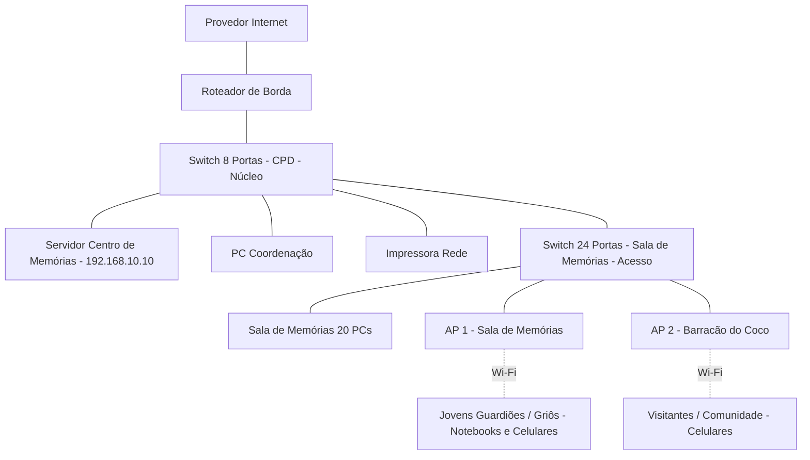

# Projeto inicial da rede
# Centro de Memórias - Rede da Casa de Memórias Quilombola

## Identificação
| Campo | Resposta da equipe |
|---|---|
| Nome da equipe | Equipe Memória Ancestral |
| Integrantes | Maria José da Silva |
| Turma | Técnico em Informática - Módulo 2 |
| Nome do projeto | Centro de Memórias - Rede da Casa de Memórias Quilombola |
| Data | 13 de outubro de 2026 |

## 1. Missão
Utilizaremos o cenário adaptado: Centro de Memórias Quilombola de Itapecuru-Mirim, com foco em criar a infraestrutura para o funcionamento do Acervo Digital de Memórias dos Griôs, da Farinhada, do Samba de Coco, do Tambor de Crioula e da Luta pelo Território.

## 2. Visão Geral e Cenário Atual
O Centro de Memórias fica no Quilombo Santa Rosa dos Pretos, em Itapecuru-Mirim. Hoje utiliza um roteador doméstico simples que atende tudo junto, sem separação de rede, caindo quando os griôs, jovens e visitantes conectam ao mesmo tempo para ver as memórias.

## 3. Objetivos
| Tipo | Objetivo |
|---|---|
| Geral | Criar uma rede hierárquica, segura e estável para salvar e divulgar as memórias ancestrais do quilombo |
| Específico 1 | Organizar cabeamento com dois switches em cascata e garantir 1 Gbps na Sala de Memórias |
| Específico 2 | Garantir cobertura Wi-Fi com 2 APs para Sala de Memórias e Barracão do Coco |
| Específico 3 | Garantir que o Servidor do Centro de Memórias tenha IP estável via reserva DHCP |
| Específico 4 | Deixar rede pronta para 20 PCs simultâneos das oficinas de jovens guardiões da memória |

## 4. Requisitos Técnicos e Restrições
| Requisito | Descrição | Prioridade | Observação D0 |
|---|---|---|---|
| Desempenho | Rede cabeada Gigabit | Alta | Switches Gigabit e cabo Cat6 |
| Segurança | Isolamento futuro entre Coordenação e Visitantes | Alta | Na D0 é necessidade futura, sem VLAN |
| Distância | Nenhuma lança >90m | Alta | Premissa a medir com trena até o Barracão |
| Energia | Nobreak para servidor | Média | Avalia na D1 |

## Parte A — Compreensão do problema
### 5. Escreva o problema
No Centro de Memórias, griôs, mestras farinheiras, tocadores de coco, jovens e visitantes precisam gravar, ouvir, assistir e compartilhar o Acervo Digital de Memórias da Casa de Farinha, do Beiju, do Samba de Coco, das Histórias dos Mais Velhos e da Luta pela Terra, além de fazer oficinas de memória, mas a casa não possui cabeamento estruturado, internet confiável e divisão entre rede pública e privada, o que deixa o servidor de memórias instável, dificulta o trabalho dos guardiões da memória e expõe os registros ancestrais a acessos indevidos e perda.

### 6. Identificar os usuários
| Grupo | Quantidade | O que fazer na rede | Prioridade |
|---|---|---|---|
| Coordenação / TI | 2 | Cuidar do servidor do Centro de Memórias e da rede | Alta |
| Griôs / Mestres do Coco | 6 | Gravar áudios e vídeos de memórias por Wi-Fi | Alta |
| Visitantes / Comunidade | 35 | Consultar acervo de memórias no celular | Média |
| Jovens Guardiões da Memória | 25 | Usar os 20 PCs para editar vídeos e fotos antigas | Alta |
**Quem administrará?** A manutenção será feita pela própria associação do Centro de Memórias, com apoio remoto do IFMA e do provedor.

### 7. Identifique os setores ou ambientes
| Setor | Usuários | Dispositivos previstos | Necessidades |
|---|---|---|---|
| Coordenação | Coordenação | 1 PC, 1 impressora | Acesso privado e impressão segura de documentos da terra |
| Sala de Memórias (Telecentro) | Jovens | 20 PCs cabeados | Conexão estável com servidor de memórias |
| Barracão do Samba de Coco | Visitantes e Griôs | Celulares, notebooks, caixa de som | Wi-Fi amplo para transmitir memórias do coco ao vivo |
| Sala Técnica / CPD | TI | Servidor, Switches, Roteador | Local fechado, ventilado e com energia protegida |

### 8. Lista de necessidades e serviços
| Usuário | Necessidade | Relacionado | Importância | Como saberemos que funciona? |
|---|---|---|---|---|
| Todos | Acessar Acervo de Memórias | Servidor web interno | Alta | Abrir http://192.168.10.10 em qualquer dispositivo |
| Coordenação | Impressão em rede | Impressão | Alta | Mandar página de teste para impressora |
| Telecentro e Wi-Fi | Usar internet externa | NAT / Roteamento | Alta | Abrir site público |
| Visitantes | Usar celular | Wi-Fi Visitantes | Média | Conectar celular e navegar |
| Coordenação | Gerenciar rede | SSH / HTTPS | Alta | Entrar na tela de configuração do switch |

## Parte B — Proposta
### 9. Selecione recursos e justifique
| Recurso | Quantidade | Necessidade atendida | Justificativa | Dúvida ou premissa |
|---|---|---|---|---|
| Switch 24 portas Gigabit | 1 | Ligar PCs da Sala de Memórias | Concentra 20 PCs + 2 APs + 1 uplink em um único ponto | Premissa: Gigabit. Sobra apenas 1 porta livre |
| Switch 8 portas Gigabit | 1 | Ligar CPD e Coordenação | Atende servidor, PC, impressora, roteador e uplink | Ligado por uplink no switch de 24 |
| Roteador de Borda | 1 | Ligar LAN com internet | Realiza NAT/roteamento; firewall a confirmar no datasheet | A confirmar no datasheet |
| Ponto de Acesso Wi-Fi 6 | 2 | Wi-Fi para griôs e visitantes | Um AP na Sala de Memórias e um AP no Barracão do Coco | Alcance real com paredes de barro? |
| Servidor Torre | 1 | Guardar Acervo de Memórias | Guarda site e banco de vídeos, fotos antigas e áudios dos griôs | Premissa: IP estável via reserva DHCP ou fixo |
| Cabo UTP Cat6 | 1 caixa 305m | Cabeamento | Garante 1 Gbps | Distância <90m |

**Cálculo de portas incluindo os 2 APs:**
Switch 24 portas: 20 PCs + 2 APs + 1 uplink = 23 usados, sobra 1 livre.
Switch 8 portas: 1 PC + 1 impressora + 1 servidor + 1 roteador + 1 uplink = 5 usados, sobram 3 livres.
Total geral: 32 portas - 28 usadas = 4 livres.

### 10. Perguntas em aberto
| Tipo | Pergunta/Premissa | Por que importa? | Como confirmar? |
|---|---|---|---|
| Pergunta | O provedor entrega fibra com ONT ou rádio? | Define se precisa de conversor | Ver poste e contrato |
| Premissa | O Acervo de Memórias precisa ser visto de fora do Centro? | Define se precisa liberar porta externa | Conversar com griôs |
| Pergunta | Os APs suportam 2 SSIDs com isolamento? | Essencial para futura separação de visitantes | Ver datasheet dos APs |

## Parte C — Topologia inicial
### 11. Desenhe a topologia
**Topologia escolhida:** Hierárquica em estrela estendida / cascata. O Roteador de Borda fica no topo, ligado ao Provedor. O Switch de 8 portas do CPD é o núcleo, onde fica o Servidor do Centro de Memórias. O Switch de 24 portas da Sala de Memórias é o acesso, ligado em cascata no Switch de 8. Os 2 APs ficam na borda de acesso, ligados no Switch de 24.

**Fluxo de tráfego:** O tráfego entra e sai somente pelo Roteador de Borda. O Switch de 8 portas na Sala Técnica é o ponto central. O Servidor está conectado diretamente nele para ter conexão Gigabit direta ao núcleo. O Switch de 24 portas está ligado em cascata no Switch de 8. Clientes Wi-Fi entram via 2 APs.

### 12. Checklist técnico de topologia
| Item | Status | Observação |
|---|---|---|
| Todos os recursos aparecem no desenho? | OK | AP1, AP2 e clientes WIFI1 e WIFI2 com ligação pontilhada |
| Cálculo de portas confere com topologia? | OK | 28 usados e 4 livres, incluindo 2 APs |
| A hierarquia de camadas está correta? | OK | APs ligados no switch de acesso |
| Bloco Mermaid fecha corretamente? | OK | Testado |
| Clientes Wi-Fi representados? | OK | WIFI1 e WIFI2 via Wi-Fi |
| Margem de expansão do switch 24? | OK | Apenas 1 porta livre, registrada para reavaliação |

## Parte D — Detalhamento lógico
### 13. Plano de endereçamento IP - Premissa inicial D0
| Dispositivo | IP Sugerido | Justificativa |
|---|---|---|
| Roteador de Borda - LAN | 192.168.10.1 | Gateway da rede |
| Switch 8 Portas - CPD | 192.168.10.2 | Gerenciamento |
| Switch 24 Portas - Sala de Memórias | 192.168.10.3 | Gerenciamento |
| Servidor Centro de Memórias | 192.168.10.10 fixo | Sem IP estável o acervo de memórias sai do ar |
| PC Coordenação | 192.168.10.11 fixo | Apoio do facilitador |
| Impressora | 192.168.10.20 fixo | Sem IP fixo a impressão falha |
| AP 1 - Sala de Memórias | 192.168.10.30 | Gerenciamento |
| AP 2 - Barracão do Coco | 192.168.10.31 | Gerenciamento |
| PCs Sala de Memórias - DHCP | 192.168.10.100 a 150 | Automático |
| Celulares e notebooks - DHCP | 192.168.10.151 a 220 | Automático |
Máscara sugerida /24. Será validado em D1.

### 14. Segurança e controle de acesso
Separação de visitantes e coordenação apenas como necessidade futura, sem VLAN na D0. Senhas diferentes para Wi-Fi do Centro de Memórias e Wi-Fi de Visitantes a definir na D1.

### 15. Serviços de rede previstos
| Serviço | Onde roda - Premissa | Para quem serve |
|---|---|---|
| Servidor Web do Acervo de Memórias | Servidor Torre 192.168.10.10 | Todos na LAN via navegador |
| DHCP | Roteador de Borda | PCs, celulares e notebooks |
| NAT / Encaminhamento | Roteador de Borda | Todos para internet |
| Impressão em rede | Impressora 192.168.10.20 | Coordenação |

### 16. Plano de testes - A executar futuramente na D1
| Teste previsto | Como será feito | Resultado esperado |
|---|---|---|
| Ping para gateway | ping 192.168.10.1 | Resposta <1ms |
| Ping para servidor | ping 192.168.10.10 | Resposta OK |
| Acesso ao acervo | Abrir http://192.168.10.10 | Página com memórias abre com vídeos e fotos |
| Impressão | Mandar página teste | Impressora imprime |
| Internet | Abrir site público | Site abre via NAT |
| Wi-Fi Sala de Memórias | Conectar celular no AP1 | Celular navega e acessa acervo de memórias |
| Wi-Fi Barracão | Conectar celular no AP2 | Celular navega no Barracão |
| Teste de cabos | Testar com testador de rede | 8 vias OK e 1 Gbps |

### 17. Orçamento estimado - Premissa D0
| Item | Quantidade | Observação |
|---|---|---|
| Switch 24 portas Gigabit | 1 | Verificar se gerenciável |
| Switch 8 portas Gigabit | 1 | Verificar se gerenciável |
| Roteador de Borda | 1 | Confirmar firewall integrado |
| AP Wi-Fi 6 | 2 | Com suporte a 2 SSIDs |
| Servidor Torre | 1 | Já existente no Centro de Memórias |
| Caixa Cabo Cat6 305m | 1 | + conectores RJ45 |
| Rack + patch panel | 1 | Premissa de que não existe |
Valores serão levantados em D1. Nobreak será orçado após levantamento elétrico.

## Parte E — Revisão
### 18. Uso de IA
| Campo | Resposta |
|---|---|
| Ferramenta usada | ChatGPT |
| Prompt usado | Como organizar uma rede pequena com 2 switches para telecentro com 20 PCs e 2 APs em um Centro de Memórias quilombola com samba de coco e farinhada? |
| Sugestão da IA | Ideia de usar 2 switches em cascata separando sala de memórias e CPD |
| Sugestão descartada | Uso de OSPF e ACLs avançados, pois a rede é pequena e estática e ainda estamos na D0 |
| Como validamos | Conferimos com apostila de cabeamento estruturado do curso e com o cenário fornecido |
| Correção pela equipe | Portas recalculadas com 2 APs, clientes Wi-Fi acrescentados no diagrama com ligação pontilhada e justificativas reescritas |

### 19. Justificativa final da proposta
O projeto Centro de Memórias atende a Casa de Memórias Quilombola com uma rede hierárquica simples e segura, pensada para o contexto comunitário de Itapecuru. A escolha de dois switches organiza o cabeamento: o de 8 portas fica no CPD junto ao servidor do acervo de memórias e o de 24 portas fica na Sala de Memórias com os 20 PCs. Dois pontos de acesso foram previstos porque um único AP não cobriria a Sala de Memórias e o Barracão do Samba de Coco devido à distância e às paredes de barro, a validar. O servidor fica no switch central para ter conexão Gigabit direta ao núcleo da LAN. O roteador realiza o NAT; a existência de firewall integrado será confirmada no datasheet. A proposta atende a demanda inicial, mas deixa apenas uma porta livre no switch da Sala de Memórias, devendo ser reavaliada caso haja expansão.

### 20. Riscos, limitações e metas a validar
| Risco ou Limitação | Impacto no Centro de Memórias | Como vamos mitigar ou validar |
|---|---|---|
| Paredes de barro e palha bloqueando Wi-Fi | Sinal fraco no Barracão do Coco | Fazer levantamento de sinal no D1 |
| Distância entre CPD e Barracão maior que 90m | Cabo UTP não pode passar disso | Medir distância real com trena |
| Apenas 1 porta livre no Switch 24 da Sala de Memórias | Sem espaço para expansão | Reavaliar switch |
| Falta de rack, patch panel e nobreak | Equipamentos soltos e sem proteção | Confirmar no local e incluir no orçamento da D1 |
| IP do servidor sem reserva | Endereço pode mudar e acervo de memórias sai do ar | Criar reserva DHCP ou IP fixo em D1 |

### 21. Checklist final de entrega
| Critério | Entendi? | Onde está no documento |
|---|---|---|
| Seção 5 - Problema | Sim | Seção 5 |
| Seção 6 - Usuários | Sim | Seção 6 |
| Seção 7 - Setores | Sim | Seção 7 |
| Seção 8 - Necessidades | Sim | Seção 8 |
| Seção 9 - Recursos e cálculo de portas com 2 APs | Sim | Seção 9 |
| Seção 10 - Perguntas | Sim | Seção 10 |
| Seção 11 - Topologia com 2 APs e clientes Wi-Fi | Sim | Seção 11 |
| Seção 12 - Checklist técnico | Sim | Seção 12 |
| Seção 13 a 17 - Parte D completa | Sim | Seções 13 a 17 |
| Seção 18 a 23 - Parte E completa | Sim | Seções 18 a 23 |

### 22. Organização dos arquivos
| Campo | Resposta |
|---|---|
| Onde o conteúdo está | README.md do repositório |
| Nome recomendado | D0-equipe-nome-do-projeto.md |
| Nome final do arquivo | D0-equipe-memoria-ancestral-centro-de-memorias.md |
| Local | Raiz do repositório e na pasta /docs |

### 23. Síntese final da equipe
| Campo | Resposta |
|---|---|
| Decisão principal | Manter servidor do Centro de Memórias no switch de 8 portas do CPD e usar 2 APs, um para cada ambiente, com clientes Wi-Fi representados no diagrama via ligação pontilhada |
| Maior dúvida restante | Como configurar a separação entre visitantes e rede interna na próxima etapa com VLANs |
| O que precisa ser validado na próxima etapa | Medir a distância real do Barracão, fazer site survey do Wi-Fi, confirmar se há rack e nobreak, confirmar firewall do roteador no datasheet, confirmar com griôs se o acervo de memórias deve ser acessado de fora e garantir IP estável com reserva DHCP |
